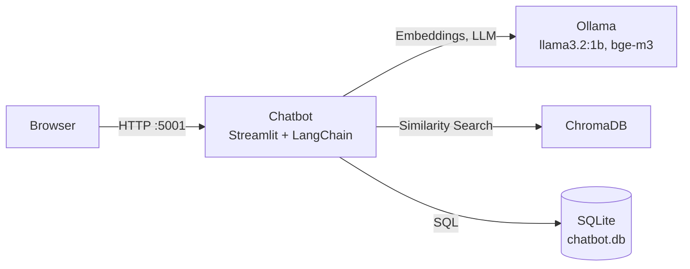

# Projekt: ChatDoc – weiterentwickelter RAG-Chatbot

ChatDoc beantwortet Fragen zum Lehrbuch `AI_Book.pdf`. Er sucht die passenden Textstellen in ChromaDB, gibt sie einem lokalen LLM (Ollama, `llama3.2:1b`) als Kontext und zeigt die Antwort zusammen mit den Quellen an. Chatverlauf und Feedback liegen in einer SQL-Datenbank (SQLite). Alles läuft lokal in Docker-Containern.

## Laborschein – wo was zu finden ist

| Vorgabe | Umsetzung |
|---|---|
| Alle 5 Sessions in eigenem Branch und Issue | Issues #6–#10, Branches `session-1` … `session-5` |
| Canvas als PDF | [Session_project/architecture-inception-canvas.pdf](Session_project/architecture-inception-canvas.pdf) |
| Personas als Markdown | [Session_project/personas.md](Session_project/personas.md) |
| User Stories als Markdown | [Session_project/user_stories.md](Session_project/user_stories.md) |
| Quality Szenarios als Markdown | [Session_project/quality_scenarios.md](Session_project/quality_scenarios.md) |
| SQL-Datenbank verwendet | SQLite, [Session_5/chatbot_task/app/src/database.py](Session_5/chatbot_task/app/src/database.py) |
| Start über docker-compose | `docker compose up --build` (siehe unten) |
| Features als Issues auf eigenen Branches | Issues #12–#15, Branches `feature/...` (siehe unten) |

## Weiterentwicklungen (Findings aus Session 5)

| Issue | Problem | Lösung | Branch |
|---|---|---|---|
| #12 | Nicht nachvollziehbar, welche Quellen verwendet wurden | Aufklappbare „Sources“ mit Seitenzahl unter jeder Antwort | `feature/quellen-anzeigen` |
| #13 | Chatverlauf geht verloren, Folgefragen werden nicht verstanden | Chats und Nachrichten in SQLite, Chat-Auswahl in der Sidebar, Verlauf im Prompt | `feature/chatverlauf-sql` |
| #14 | Antwortqualität kann nicht bewertet werden | 👍/👎 pro Antwort, Tabelle `feedback`, Statistik in der Sidebar | `feature/antwort-feedback` |
| #15 | Nur 100 Chunks indexiert, Duplikate, manuelle Schritte beim ersten Start | Ganzes Buch, deterministische IDs, Auto-Indexierung, Modelle werden automatisch geladen | `feature/vollstaendige-indexierung` |

## Starten

Voraussetzung: Docker mit Docker Compose. Beim ersten Start braucht der Ollama-Container Internet, um die Modelle zu laden.

```bash
cd Session_5/chatbot_task
docker compose up --build                                # Linux, Windows, macOS
docker compose -f docker-compose-jetson.yml up --build   # NVIDIA Jetson Orin Nano
```

Danach ist der Chatbot unter <http://localhost:5001> erreichbar.

Beim **ersten** Start lädt der Chatbot `llama3.2:1b` und `bge-m3` in Ollama und indexiert das komplette Buch (ca. 1.270 Chunks) in ChromaDB. Das kann einige Minuten dauern, der Fortschritt steht im Log (`docker logs -f chatbot`). Ab dem zweiten Start geht es schnell, weil Modelle, Index und Datenbank in `container_cache/` gespeichert sind.

Wichtige Einstellungen in `docker-compose.yml`:

| Variable | Bedeutung |
|---|---|
| `MODEL_NAME` | LLM in Ollama, z. B. `llama3.2:1b` oder `llama3.2:3b` |
| `EMBEDDING_MODEL` | Embedding-Modell, Standard `bge-m3` |
| `PULL_EMBEDDING_MODEL` | `1` = LLM und Embedding-Modell beim Start laden |
| `INDEX_DATA` | `1` = Collection neu aufbauen; eine leere Collection wird immer automatisch gefüllt |
| `SQLITE_DB_PATH` | Pfad der SQLite-Datenbank im Container (`/db/chatbot.db` → `container_cache/sqlite/`) |
| `HISTORY_MESSAGES` | Anzahl vorheriger Nachrichten, die als Verlauf an das LLM gehen (Standard 6) |

## Architektur



Ablauf einer Frage:

1. Die Frage (bei Folgefragen zusammen mit der vorherigen Frage) wird mit `bge-m3` eingebettet und in ChromaDB gesucht (k = 3).
2. Die gefundenen Chunks, der Chatverlauf und die Frage gehen in den Prompt.
3. Das LLM streamt die Antwort, die UI zeigt sie live an, darunter die Quellen.
4. Frage, Antwort und Quellen werden in SQLite gespeichert. Die Antwort kann mit 👍/👎 bewertet werden.

## Datenbankschema (SQLite)

```sql
conversations(id INTEGER PK, title TEXT, created_at TEXT)
messages(id INTEGER PK, conversation_id → conversations.id ON DELETE CASCADE,
         role TEXT CHECK (role IN ('user','assistant')), content TEXT, sources TEXT /* JSON */, created_at TEXT)
feedback(id INTEGER PK, message_id → messages.id UNIQUE ON DELETE CASCADE,
         rating INTEGER CHECK (rating IN (1,-1)), created_at TEXT)
```

Die Datenbank kann direkt abgefragt werden, z. B. alle negativ bewerteten Antworten:

```bash
sqlite3 container_cache/sqlite/chatbot.db \
  "SELECT m.content, f.rating FROM feedback f JOIN messages m ON m.id = f.message_id WHERE f.rating = -1;"
```

## Tests

```bash
cd Session_5/chatbot_task/app
uv run --with pytest python -m pytest tests
```
